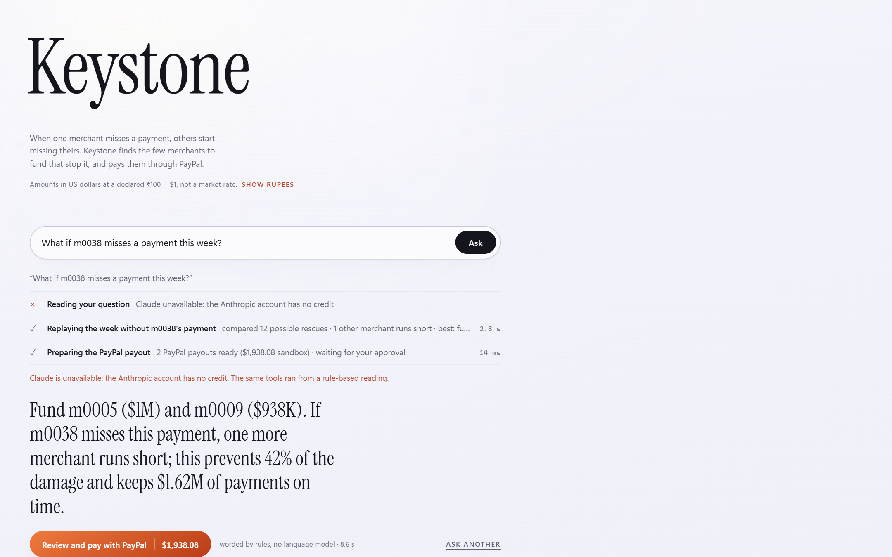
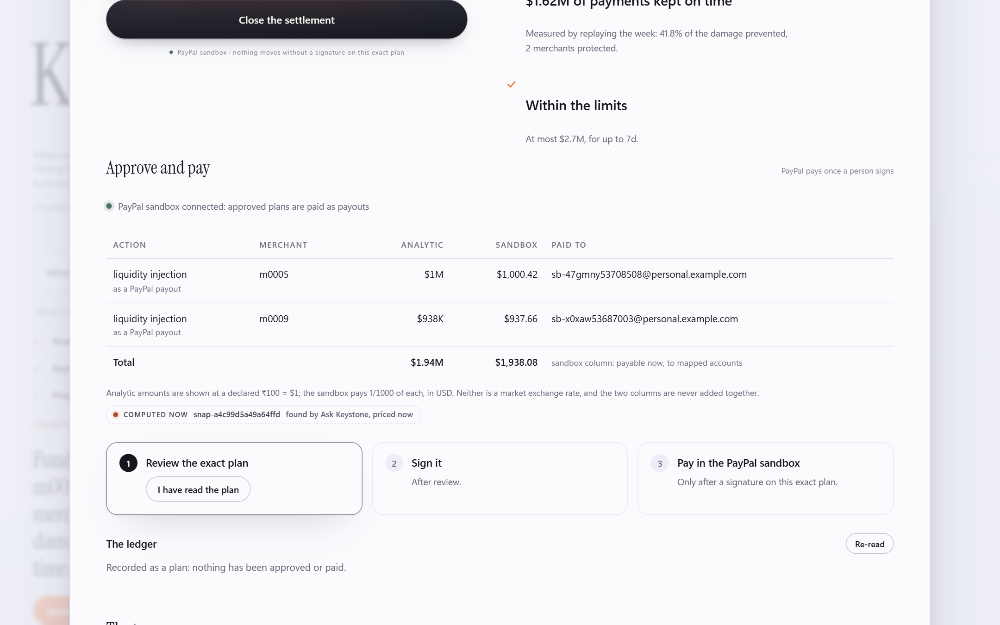
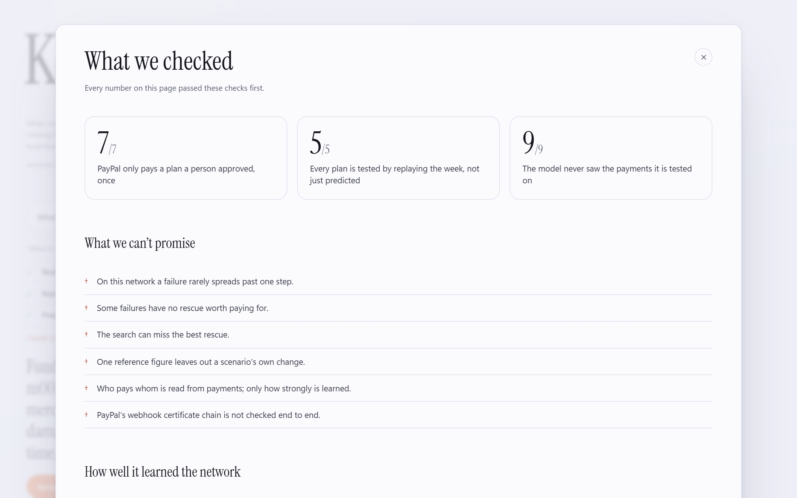
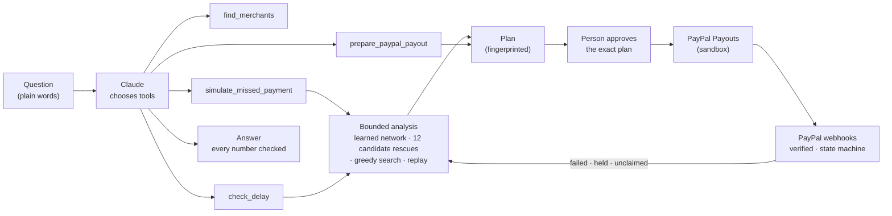

# Keystone

**When one merchant misses a payment, others start missing theirs.
Keystone finds the few merchants to fund that stop it — and pays them through PayPal.**



`PayPal Payouts + Webhooks (sandbox)` · `Claude with tool use` · `Python 3.12 · FastAPI` · `React 19` · `630+ tests` · `Apache-2.0`

---

## The idea in one picture

Merchants on a payment platform pay each other. A supplier who is paid late pays
*its* suppliers late, and the delay travels along the same lines the money does.

```
   customer ──✗──▶  m0038  ──late──▶  m0059  ──late──▶  …
                      │
                      └── one missed payment, and the damage spreads
```

A lender sees one merchant. **A payment platform sees every line between them.**
So it can answer a question nobody else can:

> **Where does the least money keep the most payments on time?**

That is Keystone: a small, hard search problem — *pick the fewest merchants to
fund, and how much, so the fewest other payments fail* — solved on a model of
who pays whom, learned from payment history, and executed through PayPal.

## What you do with it

1. **Ask in plain words.** *"What if m0038 misses a payment this week?"*
2. **Watch it work.** Claude calls Keystone's own tools, and every step is real
   computation, shown live with its timing:
   - finds the merchant you described,
   - replays the coming week without that payment, on the learned network,
   - compares a dozen possible rescues and keeps the cheapest that works,
   - checks what happens if the money arrives late.
3. **Get a short answer.** *"Fund m0005 ($1M) and m0009 ($938K). If m0038 misses
   this payment, one more merchant runs short; this prevents 42% of the damage
   and keeps $1.62M of payments on time."* Every number in it is checked against
   the tools.
4. **Approve, and PayPal pays.** One click opens the plan; a person signs it;
   Keystone sends the PayPal Payouts. PayPal's webhooks report back, and a payout
   that fails becomes a new problem that Keystone plans for again.

The four cards on the page redraw around your question: the network, who your
failure reaches, who to fund, and the payout.

## The finding

We asked the same question about 30 different merchants failing.
**In 30 of 30, the cheapest rescue funds m0005 — and in 29, it funds exactly m0005
and m0009.** Whatever breaks, the same two merchants hold the network up. They are
its keystones, and finding them is what this project does.

## How PayPal is used

PayPal is not a final "pay" button. It is the loop: money goes out, PayPal reports
what happened, and Keystone acts on the report.

| PayPal API | What Keystone does with it |
| --- | --- |
| **OAuth 2.0** (client credentials) | Gets a sandbox token. Live mode is refused in code, with no override. |
| **Payouts** — `POST /v1/payments/payouts`, `GET` batch and item | Pays each approved rescue to the merchant's PayPal account. One `PayPal-Request-Id` per *(plan, action)*, so the same plan can never pay twice — even if you click twice or the network drops. |
| **Webhooks** — `PAYMENT.PAYOUTS-ITEM.*`, `PAYMENT.PAYOUTSBATCH.*` | Verifies PayPal's RSA-SHA256 signature over the raw body, records each event once, and moves the payout through a state machine that never goes backwards. A payout that **fails, is held, or goes unclaimed** becomes a new shortfall, and Keystone finds a new plan for it. |
| **Read-only probes** | Knows what the app may do before it tries (`lce paypal doctor`). |

**Safety, enforced in code:** nothing is paid without a person approving the
exact plan (its fingerprint); sandbox only; a demo token and rate limits on the
hosted demo.

## How AI is used

Two kinds, each doing the job it is good at.

**Machine learning finds the network.** From ~11,000 past payments, Keystone maps
who pays whom (all 216 links are read straight from the payments) and *learns*
what no payment says outright: how much of a shortfall each link passes on, how
often, and how long it takes. Tested against the known truth, the learned
pass-through ranks links with **0.85** correlation. A search then tests each
candidate rescue by replaying the whole week, so a plan is *measured*, not guessed.

**Claude reads the question and explains the answer.** Claude
(`claude-opus-5-5`, strict tool use) chooses which of four tools to call —
`find_merchants`, `simulate_missed_payment`, `check_delay`,
`prepare_paypal_payout` — and words the result in two or three sentences.

- **It never picks an amount or a merchant to fund.** The search does.
- **It never pays.** A person approves; PayPal pays.
- **It cannot make up a number.** Every figure in its answer must appear in a
  tool result, or the answer is replaced by one built from the tool figures.
- **It degrades honestly.** With no API key, the same tools run from a
  rule-based reading of the question, and the page says so.

## Why this is new

Credit tools ask *"is this merchant risky?"*, one merchant at a time.
Keystone asks the network question: *"where does one dollar keep the most **other**
merchants' payments on time?"* Only the platform in the middle of the payments can
answer it, and only a platform that can move money — like PayPal — can act on the
answer in the same minute.

It builds on *Programmable Repayment: Risk-Sharing and Enforcement Through the
Payment Platform* (Rishabh and Di Stefano, 2026,
[SSRN 6729024](https://papers.ssrn.com/sol3/papers.cfm?abstract_id=6729024)),
which argues the platform can lend in ways an outside lender cannot. Keystone asks
the operational question that follows: *if the platform can place money anywhere
in the network, where should it go?*

## Run it in two minutes

```bash
pip install -e ".[dev]"
cp .env.example .env        # optional: PayPal sandbox keys and ANTHROPIC_API_KEY
sh scripts/live_sandbox.sh  # the API on http://127.0.0.1:8000
```

```bash
cd frontend && npm install && npm run dev   # open http://localhost:5173
```

It works with **no keys at all**: questions are answered by the same tools run
from rules, and plans are shown and approved but not paid. Add PayPal sandbox keys
to pay; add an Anthropic key for Claude. `sh scripts/live_sandbox.sh paypal doctor`
lists anything still missing.

## Screens

| | |
| --- | --- |
|  |  |
| **The landing.** The network, what breaks, who to fund, the payout — and one question box. | **Approve and pay.** The exact plan, each PayPal account, then review → sign → pay. |
|  | |
| **What we checked.** Three claims with their pass counts, and what we can't promise. | |

## Under the hood



| Layer | Where | What it does |
| --- | --- | --- |
| Ask Keystone | `src/lce/agent/` | Claude tool loop, the four tools, the number check, the rules fallback, streamed to the page |
| Network model | `src/lce/inference/`, `src/lce/learning/` | Learns who pays whom, and how strongly, from payment history alone |
| Search and replay | `src/lce/intervention/`, `src/lce/simulation/` | Generates rescues, picks the cheapest that works, replays the week to measure it |
| PayPal | `src/lce/paypal/`, `src/lce/execution/` | OAuth, Payouts, webhook verification, approvals, pay-at-most-once, re-planning |
| API | `src/lce/api/` | FastAPI; every number the page shows comes from here |
| Page | `frontend/` | React 19, no chart library; every figure drawn from an API field |

**What makes it hard:** the search is a budgeted choice over a network where
helping one merchant changes who the others can pay, so a plan can only be judged
by replaying the week with it. Each analysis is bounded (at most 5 failing
merchants, 12 candidate rescues, 2 actions) and runs in a few seconds on a laptop.

## Proof, and honest limits

- **Tested:** 630+ automated tests; 35 build-time checks (secrets never committed,
  live PayPal refused, unverified webhooks refused, a payout never resubmitted…);
  `ruff` and `mypy` clean.
- **Measured, not claimed:** the learned pass-through ranks the 216 links with
  0.85 correlation to the truth (timing 0.64, chance of passing on 0.38); every
  plan's effect comes from replaying the week with it.
- **Synthetic on purpose:** the 100-merchant network is generated, so every result
  can be scored against a known truth. No claim is made about real merchants.
- **Amounts:** shown in US dollars at a declared ₹100 = $1 (the network is
  generated in rupees); the sandbox pays 1/1000 of each amount.
- **What we can't promise:** on this network a failure rarely spreads past one
  step; part of what a rescue prevents would happen even without the failure
  (m0005 and m0009 are already short of cash); the search can miss the best rescue;
  PayPal's webhook certificate chain is not checked end to end. The page lists all
  of these under *What we checked*.

## What is new since October 1

Keystone began as a payment-network analysis. For this hackathon it became a
working product on PayPal:

- **PayPal execution:** OAuth, Payouts, plan fingerprints, pay-at-most-once,
  approvals, an audit trail.
- **PayPal webhooks:** signature verification, a payout state machine, and failed
  payouts that re-enter as new problems.
- **Ask Keystone:** Claude with four real tools, live steps, the number check, and
  a rules fallback.
- **The cost of waiting:** how much of a rescue survives if the money lands late.
- **A redesigned page:** USD amounts, plain words, the payout desk, the proof
  certificate.
- **Hosting:** a Render blueprint, a demo token, rate limits, `lce paypal doctor`.

## Built with

Python 3.12 · FastAPI · SQLAlchemy and Alembic · NumPy · React 19 · Vite ·
PayPal REST APIs (Payouts, Webhooks, OAuth) · Anthropic Claude API.
Development was AI-assisted (Claude Code), with every change reviewed and tested.

## Deploy

[`render.yaml`](render.yaml) deploys the API, the page and a small Postgres for
payout records. Steps, free-tier limits and the webhook setup are in
[`docs/DEPLOY.md`](docs/DEPLOY.md).

## License

[Apache-2.0](LICENSE).
