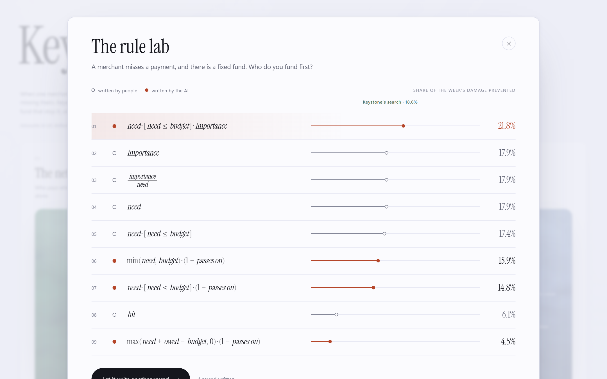
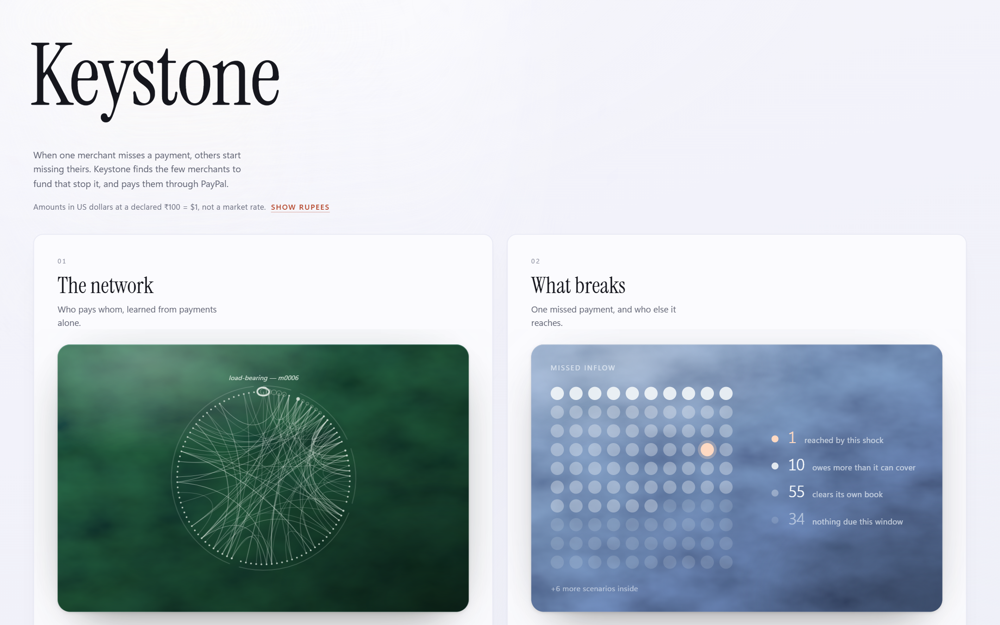
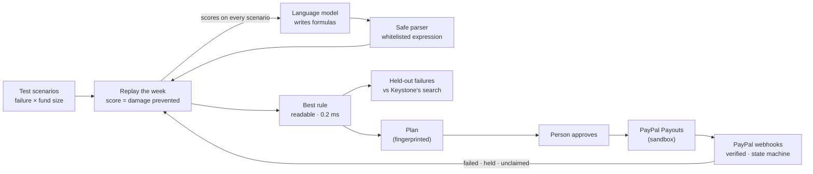

# Keystone

**When one merchant misses a payment, others start missing theirs.
Keystone finds the few merchants to fund that stop it — and pays them through PayPal.
Then it lets a language model write a better rule for who gets the money first.**



`PayPal Payouts + Webhooks (sandbox)` · `LLM-guided rule discovery` · `Python 3.12 · FastAPI` · `React 19` · `650+ tests` · `Apache-2.0`

---

## The idea in one picture

Merchants on a payment platform pay each other. A supplier who is paid late pays
*its* suppliers late, and the delay travels along the same lines the money does.

```
   customer ──✗──▶  m0038  ──late──▶  m0059  ──late──▶  …
                      │
                      └── one missed payment, and the damage spreads
```

A lender sees one merchant. **A payment platform sees every line between them.**
So it can answer a question nobody else can:

> **You have a fixed amount of money. Who do you fund first, so the fewest payments fail?**

It is a small, hard search problem — like a knapsack where every item changes the
value of the others. Keystone solves it on a model of who pays whom, learned from
payment history, and pays the answer out through PayPal.

## The rule lab: the AI writes the rule

People write rules for this: *fund the biggest gap first*, *fund the most
important merchant first*. We wrote six. **None wins everywhere.** "Biggest gap
first" collapses when a huge merchant fails, because it sinks the whole fund into
that one merchant; "whoever the money can fully fix" collapses when the fund is
small, because nothing fits.

So the lab hands the problem to a language model:

1. **The model writes rules** — one-line formulas over 14 clues Keystone knows
   about each merchant: what it owes, its cash, its learned importance, how much of
   its income it passes on, how hard this failure hits it, the size of the fund.
2. **Keystone replays the week** to score every rule on every test scenario
   (3 failures × 4 fund sizes), funding merchants in the rule's order until the
   money runs out.
3. **The best rules go back to the model**, with their score on every scenario,
   and it writes new ones aimed at where they lose. Round after round, the rules
   get better.

| Same scenarios, same money | Learned on (12) | Never seen (16) |
| --- | --- | --- |
| Best of the six rules people wrote | 17.9% | 18.4% |
| Keystone's own search (about a second per scenario) | 18.6% | 19.5% |
| **Written by the model in its first round:** `pays / (paid_by + 1) · need` | **29.9%** | **30.5%** |

*Share of the week's damage prevented. The model's rule beat the search in 12 of 12
scenarios it learned on and **16 of 16 it had never seen**.*

In words, the model found: **fund the merchants that pay many others but are paid
by few** — whose shortfall spreads furthest, and who have the fewest ways to be
rescued — in proportion to what they are short. None of the six rules people wrote
looked at the shape of the network that way. The rule is readable, decides in
about **0.2 ms instead of about 1 s**, and pays a real rescue through PayPal.

**You drive it.** Choose which failures it learns from and how big the fund is;
strike out a clue and make it win without it; write your own rule and race it;
pick two rules and ask the model to breed them; choose *quick ideas* (~3 s) or let
it *think deeply* (~45 s, its reasoning shown). Each run is live, so the model's
rules differ from run to run; every one is scored the same way.

**It is safe by construction.** The model only ever returns text. Every formula
is parsed into a whitelisted expression — numbers, clues, `+ − × ÷`, `min`, `max`,
`log`, `sqrt` and comparisons — before anything runs. Nothing it writes is
executed. A refused rule is shown with its reason.

**It degrades honestly.** With no model key (or no credit), random mutation writes
the rounds instead — the classic genetic-programming baseline — and the page says so.

## The finding

We asked about 30 different merchants failing. **In 30 of 30, the cheapest rescue
funds m0005 — and in 29, it funds exactly m0005 and m0009.** Whatever breaks, the
same two merchants hold the network up. They are its keystones.

## How PayPal is used

PayPal is not a final "pay" button. It is the loop: money goes out, PayPal reports
what happened, and Keystone acts on the report.

| PayPal API | What Keystone does with it |
| --- | --- |
| **OAuth 2.0** (client credentials) | Gets a sandbox token. Live mode is refused in code, with no override. |
| **Payouts** — `POST /v1/payments/payouts`, `GET` batch and item | Pays each approved rescue — from the search *or* from a rule the model wrote — to the merchant's PayPal account. One `PayPal-Request-Id` per *(plan, action)*, so the same plan can never pay twice. |
| **Webhooks** — `PAYMENT.PAYOUTS-ITEM.*`, `PAYMENT.PAYOUTSBATCH.*` | Verifies PayPal's RSA-SHA256 signature over the raw body, records each event once, and moves the payout through a state machine that never goes backwards. A payout that **fails, is held, or goes unclaimed** becomes a new shortfall, and Keystone plans for it again. |
| **Read-only probes** | Knows what the app may do before it tries (`lce paypal doctor`). |

**Safety, enforced in code:** nothing is paid without a person approving the
exact plan (its fingerprint); sandbox only; a demo token and rate limits on the
hosted demo.

## How AI is used

Three parts, each doing the job it is good at.

- **Machine learning finds the network.** From ~11,000 past payments, Keystone
  maps who pays whom and *learns* what no payment says outright: how much of a
  shortfall each link passes on, how often, and how long it takes. The learned
  pass-through ranks the 216 links with **0.85** correlation to the true links.
- **A language model invents the rules.** It reads every rule's score on every
  scenario and proposes new formulas, with a one-line idea for each — an
  evolutionary search in the style of DeepMind's FunSearch (*Nature*, 2024) and
  the LLM heuristic-design work that followed (EoH, ICML 2024; ReEvo, NeurIPS 2024).
  Those designed rules for packing and routing; to our knowledge this is the
  first to aim it at **who to rescue in a payment network**.
- **The replay is the judge.** No score is predicted: every rule, and the search,
  is measured by replaying the week with its plan.

## Why this is new

Credit tools ask *"is this merchant risky?"*, one merchant at a time. Keystone asks
the network question — *where does one dollar keep the most **other** merchants'
payments on time?* — and then asks a machine to discover the rule, rather than
having people guess it. Only the platform in the middle of the payments can answer
it, and only a platform that can move money, like PayPal, can act on the answer in
the same minute.

It builds on *Programmable Repayment: Risk-Sharing and Enforcement Through the
Payment Platform* (Rishabh and Di Stefano, 2026,
[SSRN 6729024](https://papers.ssrn.com/sol3/papers.cfm?abstract_id=6729024)),
which argues the platform can lend in ways an outside lender cannot. Keystone asks
the operational question that follows: *if the platform can place money anywhere
in the network, where should it go?*

## Run it in two minutes

```bash
pip install -e ".[dev]"
cp .env.example .env        # optional: PayPal sandbox keys, OPENROUTER_API_KEY or ANTHROPIC_API_KEY
sh scripts/live_sandbox.sh  # the API on http://127.0.0.1:8000
```

```bash
cd frontend && npm install && npm run dev   # open http://localhost:5173
```

It works with **no keys at all**: the lab's rounds are written by random mutation,
and plans are shown and approved but not paid. Add an OpenRouter or Anthropic key
for the model; add PayPal sandbox keys to pay. `sh scripts/live_sandbox.sh paypal
doctor` lists anything still missing.

## Screens

| | |
| --- | --- |
|  |  |
| **The landing.** The network, what breaks, who to fund, the payout, the proof — and the rule lab. | **From rule to payout.** The rule decides; the plan is replayed against the search; a person approves; PayPal pays. |
|  | |
| **What we checked.** Three claims with their pass counts, and what we can't promise. | |

## Under the hood



| Layer | Where | What it does |
| --- | --- | --- |
| Rule lab | `src/lce/discovery/` | Safe formula parser, scenarios and clues, plan building, replay scoring with a cache, the model prompt and tool, random mutation, held-out test |
| Network model | `src/lce/inference/`, `src/lce/learning/` | Learns who pays whom, and how strongly, from payment history alone |
| Search and replay | `src/lce/intervention/`, `src/lce/simulation/` | Generates rescues, picks the cheapest that works, replays the week to measure it |
| PayPal | `src/lce/paypal/`, `src/lce/execution/` | OAuth, Payouts, webhook verification, approvals, pay-at-most-once, re-planning |
| Ask in words | `src/lce/agent/` | An API endpoint where a model answers a question by calling Keystone's tools |
| API | `src/lce/api/` | FastAPI; every number the page shows comes from here; the lab streams its work |
| Page | `frontend/` | React 19, no chart library; every figure drawn from an API field |

## Proof, and honest limits

- **Tested:** 650+ automated tests (including unsafe formulas the parser must
  refuse); 35 build-time checks (secrets never committed, live PayPal refused,
  unverified webhooks refused, a payout never resubmitted…); `ruff` and `mypy` clean.
- **Measured, not claimed:** every score in the lab is a replay; the learned
  pass-through ranks the 216 links with 0.85 correlation (timing 0.64, chance of
  passing on 0.38).
- **Scope:** a 100-merchant network; not yet run on a live merchant book.
- **Amounts:** shown in US dollars at a declared ₹100 = $1 (the network is in
  rupees); the sandbox pays 1/1000 of each amount.
- **What we can't promise:** a rule that wins on the training scenarios can lose on
  new ones, which is why the lab tests on held-out failures; on this network a
  failure rarely spreads past one step; part of what a rescue prevents would happen
  even without the failure (m0005 and m0009 are already short of cash); the search
  can miss the best rescue; PayPal's webhook certificate chain is not checked end to
  end. The page lists these under *What we checked*.

## What is new since October 1

Keystone began as a payment-network analysis. For this hackathon it became a
working product on PayPal:

- **The rule lab:** a language model writes rules for who to fund first; the
  replay judges them; the best breed; a rule's plan is paid through PayPal.
- **PayPal execution:** OAuth, Payouts, plan fingerprints, pay-at-most-once,
  approvals, an audit trail.
- **PayPal webhooks:** signature verification, a payout state machine, and failed
  payouts that re-enter as new problems.
- **The cost of waiting:** how much of a rescue survives if the money lands late.
- **A redesigned page:** USD amounts, plain words, the payout desk, the proof
  certificate.
- **Hosting:** a Render blueprint, a demo token, rate limits, `lce paypal doctor`.

## Built with

Python 3.12 · FastAPI · SQLAlchemy and Alembic · NumPy · React 19 · Vite ·
PayPal REST APIs (Payouts, Webhooks, OAuth) · OpenRouter and the Anthropic API.
Development was AI-assisted (Claude Code), with every change reviewed and tested.

## Deploy

[`render.yaml`](render.yaml) deploys the API, the page and a small Postgres for
payout records. Steps, free-tier limits and the webhook setup are in
[`docs/DEPLOY.md`](docs/DEPLOY.md).

## License

[Apache-2.0](LICENSE).
