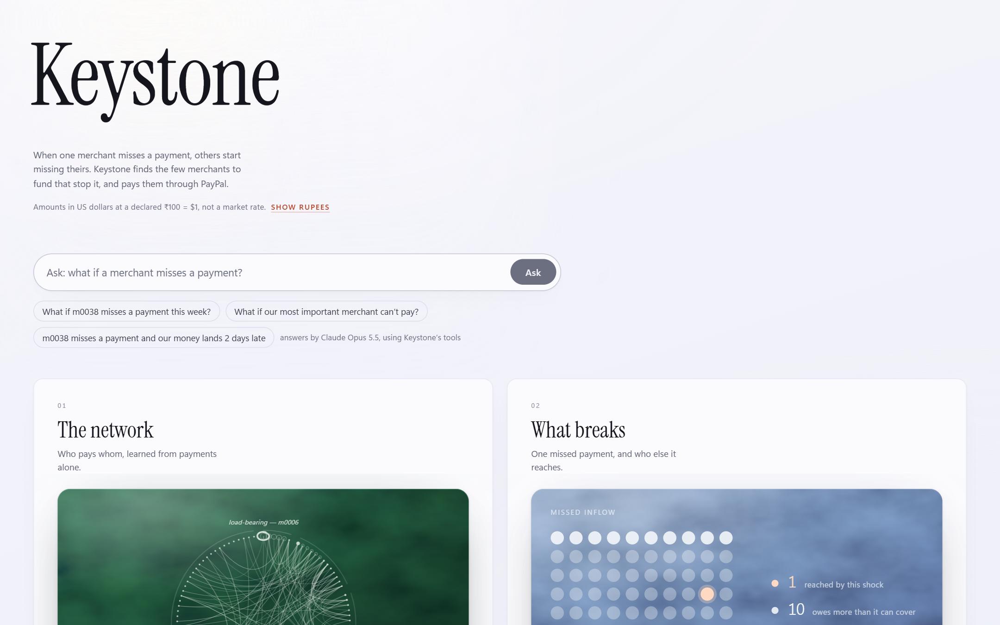

# Keystone — the page

One page: a question box, then five cards that answer it.



| Card | Shows | Opens onto |
| --- | --- | --- |
| **01 The network** | Who pays whom, learned from payments alone | Every merchant and link, the ones the rest lean on |
| **02 What breaks** | One missed payment, and who else it reaches | Each merchant hit, when, and how badly; pull any merchant yourself |
| **03 Who to fund** | The fewest dollars that keep the most payments on time | The plan, the rescues it beat, and what waiting costs |
| **04 Pay with PayPal** | The payout a person approves | Review → sign → pay in the PayPal sandbox, then the ledger PayPal's webhooks fill |
| **05 What we checked** | Three claims and their pass counts | What we can't promise, how well it learned, every check |

**Ask Keystone** sits above the cards. A question streams back as real steps —
each tool call with its result and time — then a short answer whose numbers were
checked, and *Review and pay with PayPal*. While an answer is on screen, every card
shows its analysis.

## Run it

```bash
npm install
npm run dev        # http://localhost:5173, proxies /api to the API on :8000
npm run build      # type-check and build
npm run lint
node scripts/screens.mjs   # README screenshots, with the app running
```

`LCE_API` points the dev proxy elsewhere; `VITE_API_BASE` does the same for a
separately hosted build.

## Rules the page keeps

- **No number is typed here.** Every figure comes from an API response; types are
  generated from the backend's OpenAPI schema (`src/api/schema.ts`), so a renamed
  field fails the build instead of rendering `undefined`.
- **Every figure says where it came from**: computed now, replayed offline,
  inferred, or executed in the PayPal sandbox — derived from the endpoint, never
  written by hand.
- **Money in one currency at a time.** US dollars by default at a declared
  ₹100 = $1 (the network is generated in rupees); the sandbox pays 1/1000 of each.
  A switch shows rupees.
- **Nothing moves on its own.** Motion only answers a click, is short, and stops
  under reduced motion.
- **If the API is down, the page says so** instead of showing a plausible number.

## Design

Paper and ink, one display face (Instrument Serif, OFL, self-hosted), one
terracotta accent. Each card's tile is drawn by an SVG noise filter in its own
colour — forest, slate, brass, ember, and a pale certificate for the proof — so
the cards read as objects, not charts. No chart library; every figure is drawn
from data in SVG.
